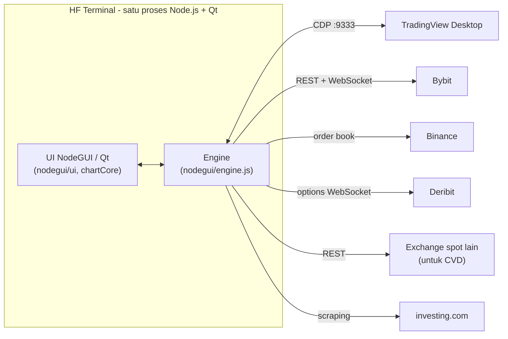

# HF Terminal

Terminal trading desktop untuk **Bybit Perpetuals** dengan chart custom berbasis **NodeGUI (Qt)** dan indikator *order-flow*: Volume Profile per-candle, Heavy Absorption, HVN Profile, Aggregated CVD, Liquidity Heatmap, Gamma Level (GEX Deribit), serta tipe chart Renko dan Footprint Delta.

TradingView Desktop dipakai sebagai pembaca riwayat candle (dikendalikan lewat Chrome DevTools Protocol), sedangkan candle & trade live datang dari WebSocket Bybit. Semua berjalan **dalam satu proses** tanpa server HTTP dan tanpa browser.

## Daftar Isi

- [Fitur](#fitur)
- [Cara Kerja](#cara-kerja)
- [Prasyarat](#prasyarat)
- [Instalasi Cepat](#instalasi-cepat)
- [Konfigurasi TradingView Desktop](#konfigurasi-tradingview-desktop)
- [Menjalankan](#menjalankan)
- [Indikator & Chart Type](#indikator--chart-type)
- [Data Lokal](#data-lokal)
- [Pengembangan](#pengembangan)
- [Indikator Pine Script (opsional)](#indikator-pine-script-opsional)
- [Troubleshooting](#troubleshooting)
- [Batasan yang Diketahui](#batasan-yang-diketahui)
- [Disclaimer](#disclaimer)

## Fitur

- **Chart candlestick custom** dengan kamera pan/zoom, crosshair, dan *drawing tools* (mis. garis, Long/Short, Fibonacci). Drawing disimpan per simbol.
- **Timeframe**: 1m, 5m, 15m, 30m, 1H, 4H, 1D, 1W.
- **Candle berjalan *by tick*** lewat WebSocket Bybit (kline + publicTrade), tanpa delay polling.
- **Lazy-load history ke kiri** lewat Bybit REST, maksimum **5000 candle** per pair/timeframe (mengikuti batas akun TradingView non-premium).
- **Cache candle** per pair/timeframe: pindah pair/TF kembali terasa instan, dan celah candle (WebSocket putus, laptop *sleep*) ditambal otomatis.
- **Indikator**: Volume, Volume Profile per-candle, Bubble (ukuran trade), Aggregated CVD, Heavy Absorption, HVN Profile, Liquidity Heatmap, Gamma Level.
- **Chart Type**: Standard, Renko, Footprint Delta.
- **Kalender ekonomi US** (3 hari ke belakang, 14 hari ke depan) dengan *auto-refresh* tepat setelah jam rilis data.

## Cara Kerja



Alur utama:

1. Saat start, engine mencari TradingView Desktop di port CDP **9333**. Bila belum berjalan, engine meluncurkan `TradingView.exe` dengan flag `--remote-debugging-port=9333` (menunggu hingga ±60 detik).
2. Saat Anda memilih pair/timeframe, engine mengatur chart TradingView ke `BYBIT:<PAIR>.P`, lalu membaca array candle dari TradingView untuk render awal yang cepat.
3. Candle yang sedang berjalan dan trade live datang dari WebSocket Bybit. History yang lebih lama (scroll ke kiri) diambil dari Bybit REST.
4. Bila TradingView tidak tersedia, terminal otomatis memakai Bybit REST untuk data awal (lihat [Mode tanpa TradingView](#mode-tanpa-tradingview)).

### Sumber data

| Data | Sumber | Catatan |
|---|---|---|
| Candle awal & daftar pair | TradingView Desktop (CDP) | Fallback: Bybit REST |
| Candle live & trade | Bybit WebSocket (`stream.bytick.com`, cadangan `stream.bybit.com`) | kline + publicTrade |
| History, sub-bar VP, metadata pair | Bybit REST (`api.bybit.com`, mirror `api.bytick.com`) | |
| Liquidity Heatmap | Binance order book: **Spot** diutamakan, fallback **USDⓈ-M Futures** | Mis. XAUUSDT hanya ada di Futures |
| Gamma Level | Deribit WebSocket | Hanya BTC & ETH |
| Aggregated CVD | Bybit, Binance, OKX, MEXC, BingX, Bitstamp, Bitunix, Coinbase (REST) | Delta dihitung dari OHLCV (aproksimasi) |
| Kalender ekonomi | investing.com (scraping, hanya US) | Cadangan: `data/cache.json` |

Semua sumber di atas adalah **data publik**: tidak ada API key dan tidak ada eksekusi order di dalam kode.

## Prasyarat

| Kebutuhan | Keterangan |
|---|---|
| **Windows 10/11** | Dikembangkan di Windows. Peluncuran otomatis TradingView mencari versi **Microsoft Store** di `C:\Program Files\WindowsApps`. macOS/Linux belum diuji. |
| **Node.js ≥ 18** | Persyaratan NodeGUI. Dikembangkan dengan Node v24.14.0 dan npm 11.9.0. |
| **TradingView Desktop** | Instal dari Microsoft Store dan **login**. Akun non-premium cukup. Dikembangkan dengan versi 3.5.0. |
| **Internet** | Akses ke Bybit, Binance, Deribit, investing.com, dan bursa lain untuk CVD. |
| **Ruang disk ±600 MB** | `node_modules` ±530 MB (sebagian besar binary Qt dari NodeGUI). |
| *(Opsional)* **CMake + Visual Studio Build Tools (C++)** | Hanya bila unduhan binary *prebuilt* NodeGUI gagal dan npm terpaksa meng-compile dari source. |

## Instalasi Cepat

```powershell
git clone https://github.com/mastersyariq/Terminal-Crypto-V.1.1.git
cd Terminal-Crypto-V.1.1
npm install        # atau: npm ci  (instal persis sesuai package-lock.json)
```

Lalu:

1. Instal **TradingView Desktop** dari Microsoft Store, buka sekali, dan login.
2. **Tutup TradingView sepenuhnya** (cek juga tray dan Task Manager) agar terminal yang meluncurkannya dengan debug port. Lihat [penjelasannya](#konfigurasi-tradingview-desktop).
3. Jalankan terminal:

```powershell
npm start
```

Instalasi pertama mengunduh binary NodeGUI/Qt, jadi butuh internet dan bisa memakan waktu beberapa menit.

## Konfigurasi TradingView Desktop

### Kenapa perlu konfigurasi khusus

Terminal mengendalikan TradingView lewat **Chrome DevTools Protocol (CDP)**: mengganti simbol/timeframe dan membaca candle dari chart. Untuk itu TradingView harus dijalankan dengan flag:

```
--remote-debugging-port=9333
```

Terminal melakukannya otomatis, **tetapi hanya bila TradingView belum berjalan**. Bila TradingView sudah terbuka tanpa flag tersebut, port debug tidak tersedia dan terminal akan menunggu hingga timeout lalu jatuh ke mode fallback. Solusinya: tutup TradingView dulu, atau jalankan manual dengan flag (di bawah).

### Peluncuran manual dengan debug port

Jalankan di PowerShell (skrip ini mencari versi TradingView terbaru yang terpasang):

```powershell
$tv = (Get-ChildItem 'C:\Program Files\WindowsApps' -Directory -Filter 'TradingView.Desktop_*' |
       Sort-Object Name | Select-Object -Last 1).FullName
& "$tv\TradingView.exe" --remote-debugging-port=9333
```

### Verifikasi port debug aktif

Setelah TradingView terbuka, buka `http://localhost:9333/json` di browser. Bila port aktif, akan tampil daftar halaman TradingView dalam format JSON.

### Aturan pakai

- Gunakan layout **satu chart**. Terminal mengendalikan *active chart widget* TradingView.
- **Jangan ubah simbol/timeframe langsung di TradingView** saat terminal berjalan. Terminal akan menimpanya setiap kali Anda berganti pair/TF di terminal.
- Terminal selalu memakai kontrak perpetual Bybit (`BYBIT:<PAIR>.P`).

### Mode tanpa TradingView

Bila TradingView tidak ditemukan atau gagal dijalankan, terminal otomatis memakai Bybit REST (±1000 candle awal) dan daftar pair dari Bybit. Anda juga bisa memaksa mode ini dengan environment variable `HF_NO_TV=1`:

```powershell
# PowerShell
$env:HF_NO_TV = "1"; npm start
```
```bat
:: cmd
set HF_NO_TV=1 && npm start
```

> `start.vbs` tidak meneruskan environment variable per-sesi. Untuk mode ini gunakan `npm start`, atau set variabel di environment sistem.

### Mengganti port CDP

Port **9333** sengaja dipilih agar tidak bentrok dengan 9222 (default Chrome DevTools). Untuk menggantinya, ubah konstanta `CDP_PORT` di `nodegui/engine.js` (GUI). Untuk mode web lama, ubah juga `server.js`, termasuk argumen `--remote-debugging-port=9333` yang tertulis langsung di dalamnya.

## Menjalankan

| Perintah | Fungsi |
|---|---|
| `npm start` / `npm run gui` | Menjalankan terminal desktop NodeGUI (console terlihat) |
| Dobel-klik `start.vbs` | Menjalankan terminal **tanpa jendela console**; log ke `nodegui.log` |
| `npm run web` | Versi browser lama: `server.js` + `public/index.html` di `http://localhost:3000` (*legacy*) |
| `npm run dev` | Sama seperti `web`, dengan `nodemon` (auto-restart) |

Log aplikasi ditulis ke `nodegui.log` (direset otomatis bila melebihi 1 MB). Bila jendela tidak muncul, jalankan `npm start` agar pesan error terlihat di console.

Setiap kali dibuka, terminal memuat **BTCUSDT 1H**. Toolbar berisi pemilih pair, tombol timeframe, menu **Indicator**, tombol **Chart Type**, dan *drawing tools*. Konfigurasi tiap indikator ada di tombol **⋮** di sebelah nama indikator. Panel kalender ekonomi dibuka dari sidebar.

## Indikator & Chart Type

| Fitur | Ringkasan | Sumber |
|---|---|---|
| **Volume Profile per-candle** | Profil volume di dalam tiap candle dari sub-timeframe | Bybit REST |
| **Bubble** | Gelembung ukuran trade per level harga | Bybit trade WS |
| **Aggregated CVD** | Cumulative Volume Delta lintas bursa spot (pilih bursa di config) | REST multi-bursa |
| **Heavy Absorption** | Sinyal bila volume melewati `mean + k × stdev` dari N bar sebelumnya (threshold bisa diatur) | Trade live + volume candle |
| **HVN Profile** | Zona High Volume Node per periode (1m … Weekly) dengan POC, diperpanjang sampai tersentuh | Candle + tickSize Bybit |
| **Liquidity Heatmap** | Heatmap order book per candle, gaya Bookmap (agregasi Peak / Average / Close) | Binance order book |
| **Gamma Level** | GEX per strike, Gamma Flip, Call/Put Wall, Max Gamma | Deribit (BTC & ETH saja) |
| **Renko** | Brick berbasis ATR atau ukuran tetap | Candle TF aktif |
| **Footprint Delta** | Tabel delta (buy − sell) per baris harga di tiap candle | Bybit trade WS |

Indikator berbasis waktu (VP, Bubble, CVD, Heavy Absorption, HVN, Liquidity) otomatis dinonaktifkan di chart Renko. Gamma Level hanya aktif pada BTCUSDT/ETHUSDT.

Penjelasan rinci tiap indikator, rumus, dan parameter ada di **[docs/NodeGUI.md](docs/NodeGUI.md)**.

## Data Lokal

File berikut dibuat otomatis saat aplikasi berjalan dan sudah masuk `.gitignore`:

| Lokasi | Isi |
|---|---|
| `data/ui-prefs.json` | Preferensi UI (konfigurasi indikator, gaya drawing, tipe chart) |
| `data/liquidity/<SYMBOL>.bin.gz` | Rekaman order book Binance (maks. 2 hari) |
| `data/footprint/<SYMBOL>.json.gz` | Agregat trade per menit per level harga (maks. 2 hari) |
| `data/cache.json` | Cache kalender ekonomi (dipakai bila investing.com gagal diakses) |
| `drawings.json` | Drawing per simbol |
| `nodegui.log` | Log aplikasi |

Heatmap likuiditas dan footprint **hanya terisi sejak aplikasi dibuka**, karena tidak ada history publik untuk order book maupun trade lewat WebSocket. Karena itu datanya disimpan ke disk agar tidak hilang saat aplikasi ditutup.

## Pengembangan

### Struktur proyek

```
hf-terminal/
├─ nodegui/               aplikasi desktop (NodeGUI / Qt)
│  ├─ main.js             jendela utama + wiring komponen
│  ├─ engine.js           engine data in-process (TradingView CDP, Bybit, cache, CVD, kalender, ...)
│  ├─ canvas2d.js         shim Canvas2D di atas QPainter
│  ├─ prefs.js            pengganti localStorage -> data/ui-prefs.json
│  ├─ chart/              chartCore.js (HASIL BUILD, jangan diedit langsung) + chartView.js
│  └─ ui/                 sidebar, toolbar, status bar, popup, dialog config, kalender
├─ lib/                   modul data: tvSync, cdpClient, bybitWS, bybitKlines, store,
│                         liquidityBook, binanceSymbols, footprint, deribitGamma, ...
├─ tools/                 build_core.js + core_parts/ (potongan kode chart)
├─ public/index.html      chart versi browser asli (sumber untuk chartCore.js)
├─ server.js              server Express untuk versi browser lama (npm run web)
├─ pine/                  indikator Pine Script untuk TradingView (opsional)
├─ tests/                 skrip uji mandiri
├─ docs/NodeGUI.md        catatan teknis per fitur
├─ data/                  data runtime (di-gitignore)
└─ start.vbs              peluncur tanpa console (Windows)
```

### Membangun ulang `chartCore.js`

`nodegui/chart/chartCore.js` **dihasilkan otomatis** dari `public/index.html` ditambah potongan di `tools/core_parts/`. Ubah sumbernya, bukan file hasil build, lalu bangun ulang:

```powershell
node tools/build_core.js
```

Membangun ulang dari isi repo ini menghasilkan `chartCore.js` yang identik byte-per-byte dengan yang ada di repo.

### Menjalankan tes

Skrip uji berdiri sendiri (tanpa framework), mencetak `PASS`/`FAIL`. Jalankan setelah `npm install`:

```powershell
node tests/test_ha_core.js
```

| Tes | Yang diuji | Internet |
|---|---|---|
| `test_ha_core.js` | Config Heavy Absorption (persistensi, clamp, debounce) | Tidak |
| `test_footprint_lib.js` | `FootprintBook`: level harga, agregasi lintas TF, persistensi, rebase tick | Tidak |
| `test_chartlogic.js` | Agregasi Peak/Avg/Close Liquidity Heatmap pada data live (±75 detik) | Ya (Binance) |
| `test_fallback.js` | Aturan fallback Binance Spot → Futures (3x gagal, kembali ke Spot) | Ya |
| `test_resolver.js` | Pemetaan simbol Bybit → Binance (mis. `1000PEPEUSDT`) | Ya |

Tes yang butuh internet dapat gagal bila Binance tidak terjangkau (lihat [Troubleshooting](#troubleshooting)).

## Indikator Pine Script (opsional)

`pine/HeavyAbsorption_HVNProfile.pine` adalah versi **Pine Script v6** dari indikator Heavy Absorption + HVN Profile untuk dipakai langsung di TradingView. File ini **tidak diperlukan** untuk menjalankan terminal.

1. Buka TradingView → **Pine Editor**.
2. Tempel isi file, lalu **Save** dan **Add to chart**.
3. Mode *Footprint* membutuhkan plan Premium/Ultimate; mode *Aproksimasi Intrabar* berjalan di semua plan (sesuai catatan di dalam skrip).

## Troubleshooting

| Gejala | Penyebab / solusi |
|---|---|
| Log: `TradingView.exe not found in WindowsApps` | TradingView Desktop (versi Microsoft Store) belum terpasang. Instal, atau pakai [mode tanpa TradingView](#mode-tanpa-tradingview). |
| Layar loading lama lalu data datang dari Bybit; log `Could not start TradingView Desktop (timeout)` | TradingView kemungkinan sudah berjalan **tanpa** debug port. Tutup sepenuhnya lalu jalankan ulang terminal, atau [luncurkan manual](#peluncuran-manual-dengan-debug-port). |
| `http://localhost:9333/json` tidak bisa dibuka | Debug port tidak aktif atau port dipakai aplikasi lain. Lihat [Mengganti port CDP](#mengganti-port-cdp). |
| Chart TradingView tidak berpindah pair/TF | Pastikan layout satu chart dan chart tersebut aktif. TradingView diakses lewat properti internalnya, jadi update TradingView bisa mengubah perilaku (lihat [Batasan](#batasan-yang-diketahui)). |
| Heatmap kosong: `LIQ · no Binance data for <SYMBOL>` | Binance tidak terjangkau atau simbol tidak terdaftar. Terminal mencoba ulang tiap 5 menit. Lihat baris berikutnya. |
| HTTP **403** dari `api.binance.com` (spot) | Teramati **intermiten** pada jaringan pengembang, sementara Futures (`fapi.binance.com`) dan Bybit tetap normal. Bisa disebabkan pembatasan wilayah/ISP atau WAF. Terminal akan fallback ke Futures bila ada; bila tetap bermasalah, coba jaringan/VPN lain sesuai aturan setempat. |
| Log: `Bybit kline: Too many visits. Exceeded the API Rate Limit.` | Rate limit sesaat saat buffering history yang cepat. Dalam log pengembang, buffering berlanjut setelah error tersebut. |
| Footprint / heatmap kosong di candle lama | Wajar: data baru terisi sejak aplikasi dibuka (lihat [Data Lokal](#data-lokal)). |
| Kalender tidak termuat | investing.com bisa memblokir permintaan (mis. Cloudflare). Terminal memakai `data/cache.json` bila ada. |
| `npm install` gagal di NodeGUI | Pastikan Node ≥ 18 dan internet stabil, lalu ulangi. Bila tetap gagal, npm mencoba compile dari source (butuh CMake + Visual Studio Build Tools). Dokumentasi: <https://docs.nodegui.org/> |
| Jendela tidak muncul saat memakai `start.vbs` | `start.vbs` menyembunyikan console. Jalankan `npm start` untuk melihat error, atau baca `nodegui.log`. |

## Batasan yang Diketahui

- **Bergantung pada API internal TradingView Desktop** (mis. `_exposed_chartWidgetCollection`). API ini tidak resmi dan bisa berubah di update TradingView; sebelumnya perubahan UI TradingView pernah mematahkan pemilihan timeframe.
- **Windows saja** untuk peluncuran otomatis TradingView (versi Microsoft Store).
- **Buffer maksimum 5000 candle** per pair/timeframe.
- **Gamma Level** hanya untuk BTC dan ETH.
- **CVD** dihitung dari OHLCV candle (aproksimasi), bukan dari trade individual.
- **Heatmap & Footprint** tidak punya riwayat sebelum aplikasi dibuka.
- Mode web lama (`npm run web`) dipertahankan sebagai *legacy*.

## Disclaimer

- Proyek ini adalah **alat visualisasi data pasar**, bukan nasihat keuangan atau ajakan membeli/menjual aset apa pun. Trading derivatif berisiko tinggi; gunakan dengan risiko Anda sendiri.
- Proyek ini **tidak berafiliasi** dengan TradingView, Bybit, Binance, Deribit, atau Investing.com. Semua merek dagang adalah milik masing-masing pemiliknya.
- Mengendalikan TradingView Desktop lewat CDP dan mengambil data kalender dari investing.com memakai jalur **tidak resmi**. Periksa dan patuhi syarat layanan masing-masing platform sebelum memakainya.
